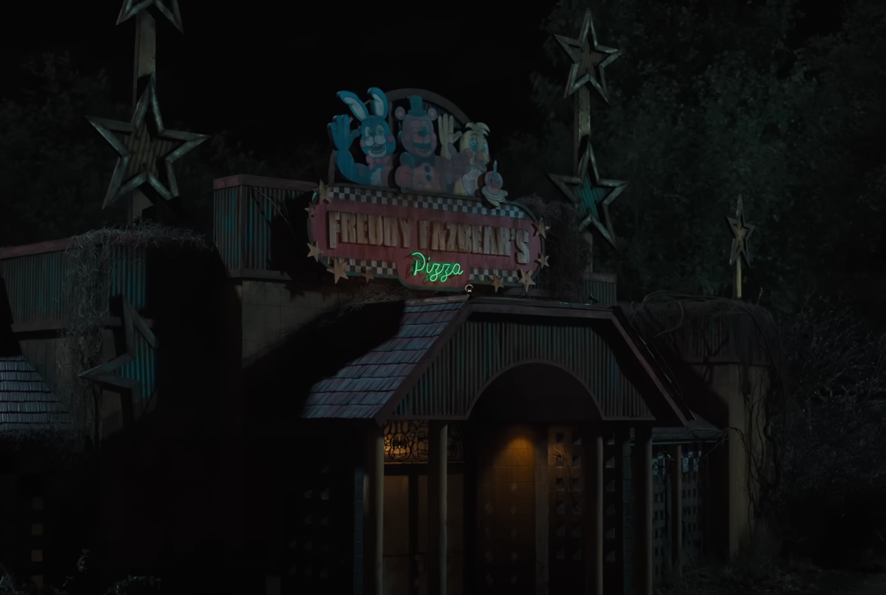

You stand on the cold pavement, watching the neon breathe above the restaurant. The night air carries the faint clatter of somewhere else—somewhere that isn't here—and the building's silhouette looks smaller and more human than it did in daylight, like a creature that knows how to wait.

Your breath fogs in the beam of the lone streetlight. The back door is propped open a few inches; warm light and the smell of oil drift out. A small hand-lettered sign on the window lists tonight's specials and the shift hours.

Your keys press into your palm. Behind you, the parking lot is an empty stage. Ahead, the entrance holds the beginning of your first shift.

What do you do?

- [Step inside and begin your first night shift](./scene5-night.md)
- [Circle the building and check the exterior](./Scene4C.md)
- [Change your mind and leave](./_start-here.md)
