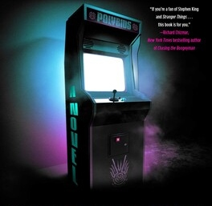

You walk over to the loud, flashing arcade game at the corner. You see a glimpse of a little boy standing on the chair playing the game. You call out:

"Hey, what are you doing here? Are you lost? No one is supposed to be here this time of night."

The boy turns to look at you then jumps off the chair and runs around the corner. You quickly run after him, and as you turn the corner, there is nothing there but a trash bin.

What do you do?

- [Do you go back to the office to look at cameras?](./scene8a.md)
- [Do you leave?](./_start-here.md)