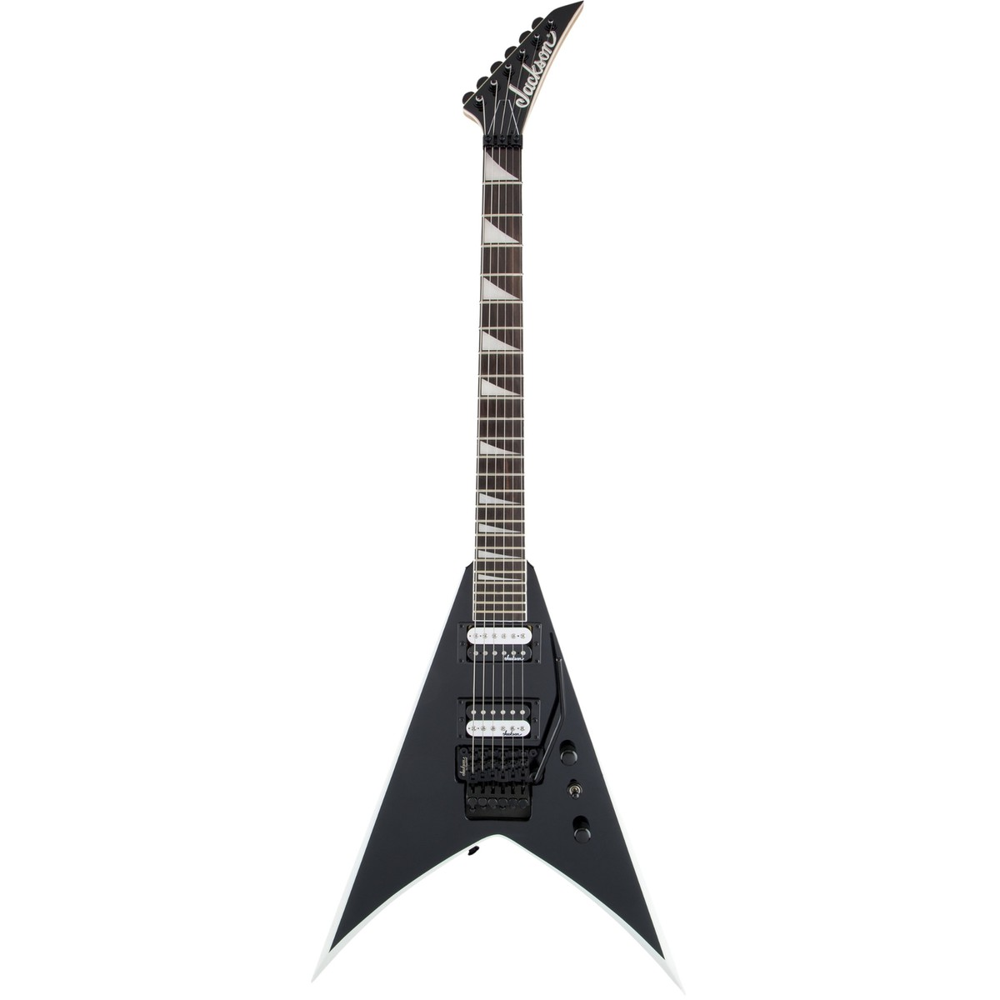

# Happiest Day

## Night 5

### 12:00am

You reached your place of work, the haunted house. Something or someone is giving you a signal saying today is your last shift. Alongside doing your normal stuff, you look around for a guitar at 5:30 a.m., you find the final thing you're looking for, the red guitar, like everything else. The mysterious amulet glows, and the guitar is gone.

Finish your last 30 minutes of today's shift and hear the clock chime 6:00 a.m., you head home feeling accomplished, somehow like you helped people

- ✅ [Go home](./Scene11_GE.md)