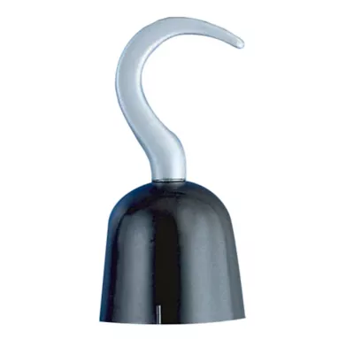

# Happiest Day

## Night 4

### 12:00am

Well, while doing your normal work, you stumble upon the same pirate hook you saw in your dream. The amulet in your pocket starts glowing, and just as fast as you found the pirate hook, it disappears. You hear the voice a lot clearer this time, saying one more night, you tell yourself this place is probably haunted, and I might as well finish off one more night and help whatever is compelling me to find these items

Fully awake, realizing this place has a lot more going on than you thought, you head home as you hear the clock strike 6:00 a.m. Your way home, you think about everything that's happened, and you realize something's telling you there's one final thing you need to collect

- ✅ [Go home](./Scene9_GE.md)